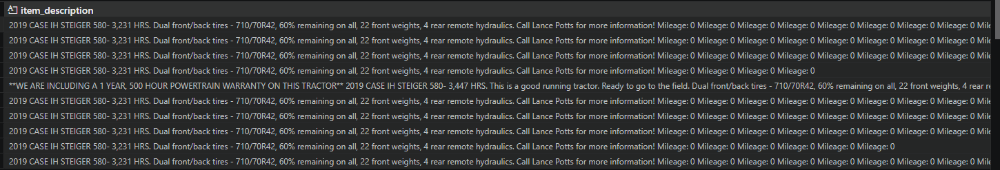

I think for NRT items we can break down the tasks into simpler steps. Main idea is to treat pulsar and flink integration as a separate step. I say we get all new python logic implemeneted, reviewed, and tested before adding the flink/pulsar integration

Kyler has task [[RecSys NRT - Flink listing update router]]
Currently the task is to create entire flink job, but it can be broken down into individual parts which IMO can be their own tasks
1. [[Get Listing Details Service]]
2. [[Listing Update Determiner]]
3. [[New Flink Listing Update Router]]

Shayne has task [[RecSys NRT - recsys_data_prep updates]]
Believe we can break it into 2 phases 
[[RecsysLastModifed update]]
[[RecsysLastModifed update Phase 2]]

Andrew has task [[RecSys NRT - Flink ES worker]]
think we can break it up into an
[[ES Writer Service]]
For my task of RecSys NRT - MediaID storage, retreiving mediaID details will be done in multiple places. For one, generating the listing's similarItemsEmbedding will require its image embedding. The other 
For my task of Deploy RecSys Models

Took a look at the backlogs and here are my two cents. I think we should split a majority of these backlogs into multiple tasks with multiple Prs. We can start working on the new logic to recsys that will eventually use Pulsar and Flink before we get them deployed, so there won't be any blockers. I say it would be worth it to implement the logic, get it tested and reviewed, then come back and add it to the new ecosystem. With Kyler's task for the Flink Listing update router for example, I identified 3 parts that can be implemented separately 
Get Listing Details Service
- Service that gets the listing details from source. Currently logic exists in recsys data prep, it would be nice to encapsulate it in its own service. Differences to how recsys data prep handles it: for one, we can no longer rely on the DB CSVs for getting the most up to date listing information, so we will need a different way to get some columns. Another thing that can be included in this service is the ability to only get a subset of columns from source. This can make updates more "NRT" like because we are bottlenecked on grabbing some fields in recsys data prep. An example is ListingDisplayAvailability. Right now there is an expensive API call for all listings that can be avoided if we design this right.
- The other thing is how it gets placeholder predictions. Currently we use DTA's imagescoringresult/searchgetlist endpoint, which can result in stale predictions. In order to get DTA's most up to date predictions, we have to hit a python api. This python api is fragile so we wouldn't want to hit it a lot. Instead we can handle media Id details in its own service

Listing Update Determiner
- Service that determines what type of update is needed, given a payload. One part that wasn't included in the task but I see could be benefical is to add a layer to compare the update to what we currently have in ES, to see if it would be worth re running.
Couple things to chew on: 
- Make is currently a field that affects embedding. For a given listing ID, if we have {"Make":"Ford"} in ES, and an update event comes through to update the Make to Ford, what do we do? Classify it as a No Op, or a GPU update?
- if we have {"Make":"Ford"} in ES, and an update event comes through to update the Make to FORD, what do we do? Classify it as a No Op, or a GPU update?
- Last month I found this weird behavior where there were descriptions that were being updated, by adding a spec value. . Is it really worth running the whole pipeline for updates that look like a bug

Then finally, the router.
- The router should then use these services, alongside flink and pulsar to create the end product

For my task of RecSys NRT - Deploy RecSys Models, to get the similar items embedding, it will need the image embedding. Instead of computing it everytime, we could leverage the  

Retreiving mediaID details will be done in multiple places. We want to compute the media IDs embedding once, and only call DTA's image classification api when we need to. That is why I propose a new service, that handles the retreival of mediaID details. 
Then the recsys api will just worry about getting the mediaIDs embedding, and not have to worry about caching or anything.
Same with the Get Listing Details Service, it will only have to get the placeholder predictions, not introduce logic to cache them

[RecSys NRT - Flink listing update router]: <Tasks/RecSys NRT - Flink listing update router.md> "RecSys NRT - Flink listing update router"
[Get Listing Details Service]: <Tasks/Get Listing Details Service.md> "Get Listing Details Service"
[Listing Update Determiner]: <Tasks/Listing Update Determiner.md> "Listing Update Determiner"
[RecSys NRT - Flink ES worker]: <Tasks/RecSys NRT - Flink ES worker.md> "RecSys NRT - Flink ES worker"
[RecSys NRT - recsys_data_prep updates]: <Tasks/RecSys NRT - recsys_data_prep updates.md> "RecSys NRT - recsys_data_prep updates"
[ES Writer Service]: <Tasks/ES Writer Service.md> "ES Writer Service"
[RecsysLastModifed update]: <Tasks/RecsysLastModifed update.md> "RecsysLastModifed update"
[RecsysLastModifed update Phase 2]: <Tasks/RecsysLastModifed update Phase 2.md> "RecsysLastModifed update Phase 2"
[New Flink Listing Update Router]: <Tasks/New Flink Listing Update Router.md> "New Flink Listing Update Router"
